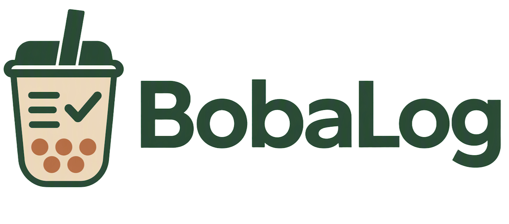

# BobaLog

手搖飲生活化工具——記錄你喝過的每一杯,發現附近好喝的新選擇。

BobaLog 是一個全端開發的手搖飲追蹤與探索平台,整合品牌菜單瀏覽、飲用紀錄、地圖搜尋附近店家、AI聊天助手(自動記帳、個人化推薦)、評分與留言,以及社群回報菜單異動的審核機制,讓使用者從「喝」這件小事出發,累積屬於自己的手搖飲足跡。

## 線上Demo

🔗 [boba-log-one.vercel.app](https://boba-log-one.vercel.app)

## 功能

### 首頁

打開網站就能看到所有品牌清單與搜尋入口,直接搜尋想找的品牌或飲料,點擊卡片快速進入該品牌的菜單頁。

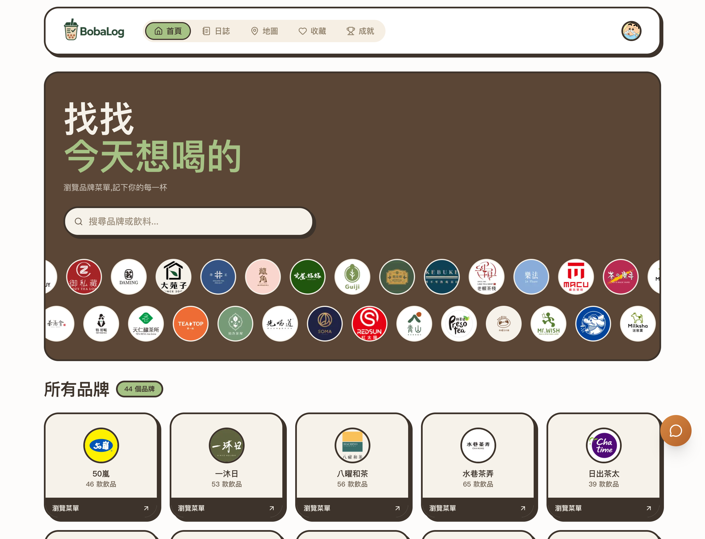

### 品牌菜單瀏覽

瀏覽40多個手搖飲品牌的完整菜單,依分類篩選、搜尋飲料,每款飲料顯示雙尺寸價格與使用者評分;品牌有加料資訊時,另外提供彈出視窗查看加料品項與價格。

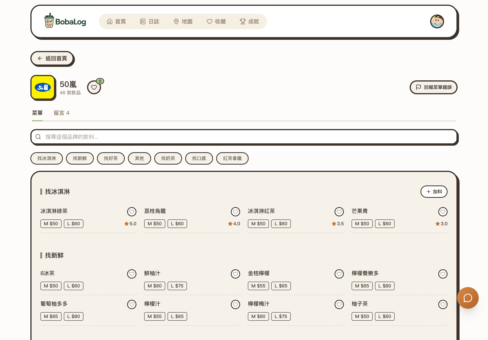

### 飲料評分與留言

點進單一飲料頁面查看平均評分、留言分享心得,也能直接在這裡評分、留言,並編輯或刪除自己的留言。

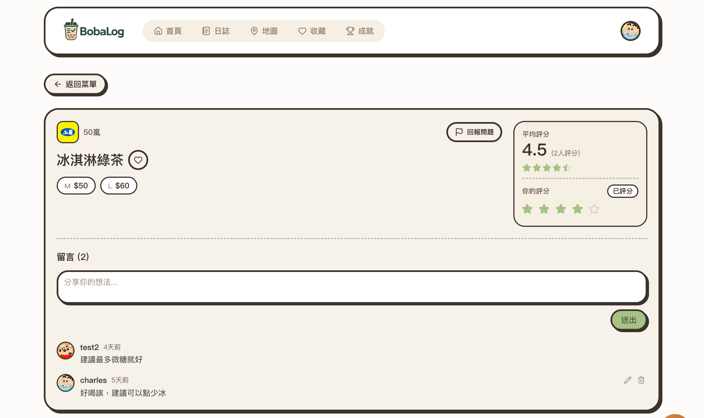

### 記帳日誌

快速記錄每一筆手搖飲消費,支援常用飲品快速記帳、跨品牌搜尋,並提供本月花費、平均每杯價格、連續記帳天數、當月最愛品牌與飲料排行榜等統計。

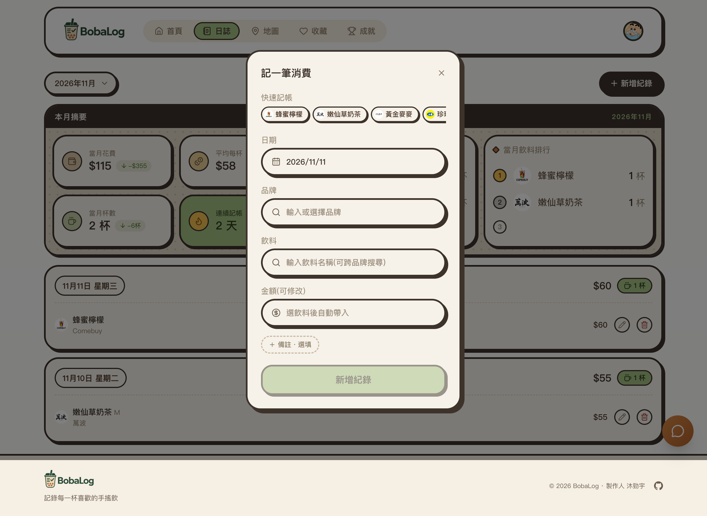
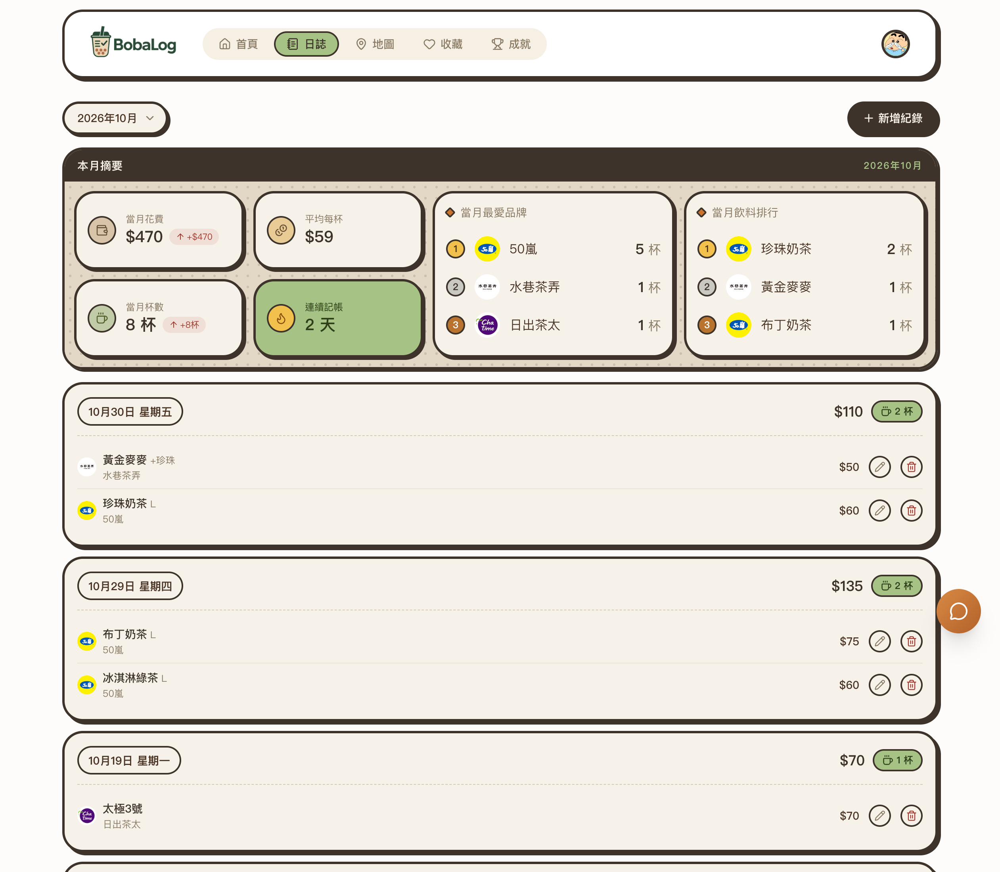

### 地圖搜尋

串接Google Places API,顯示附近手搖飲店家的即時位置、營業狀態與營業時間,點擊可直接前往該品牌的菜單頁。

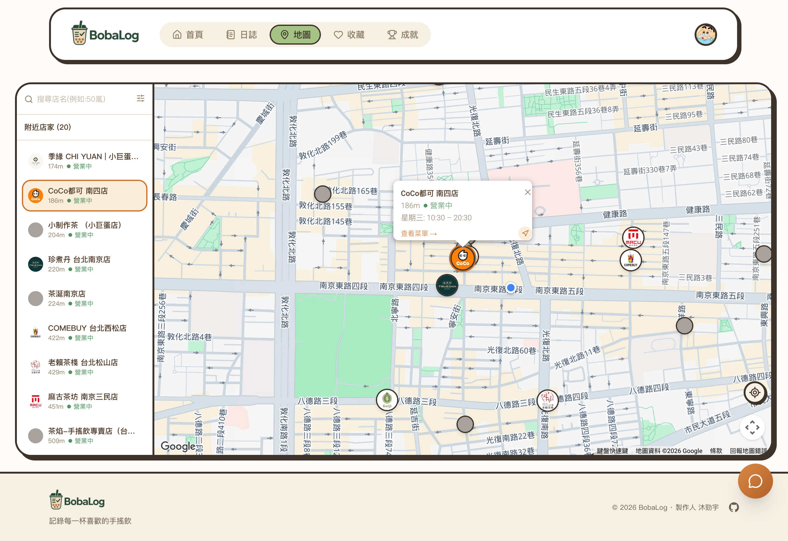

### 收藏與排序

收藏喜歡的品牌或飲料,並透過拖曳自訂顯示順序。

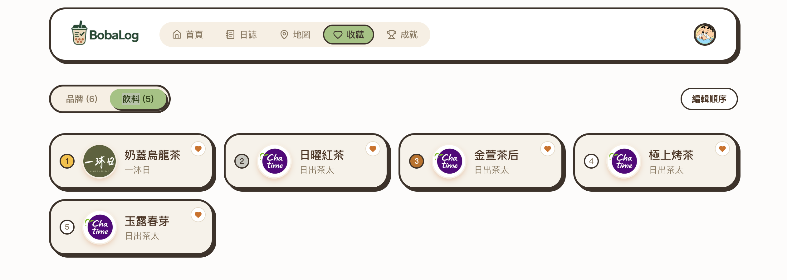
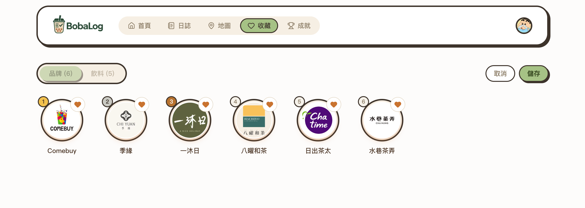

### 成就系統

累積紀錄、收藏、評分、留言等行為可以解鎖不同成就勳章,並顯示下一個目標的完成進度。

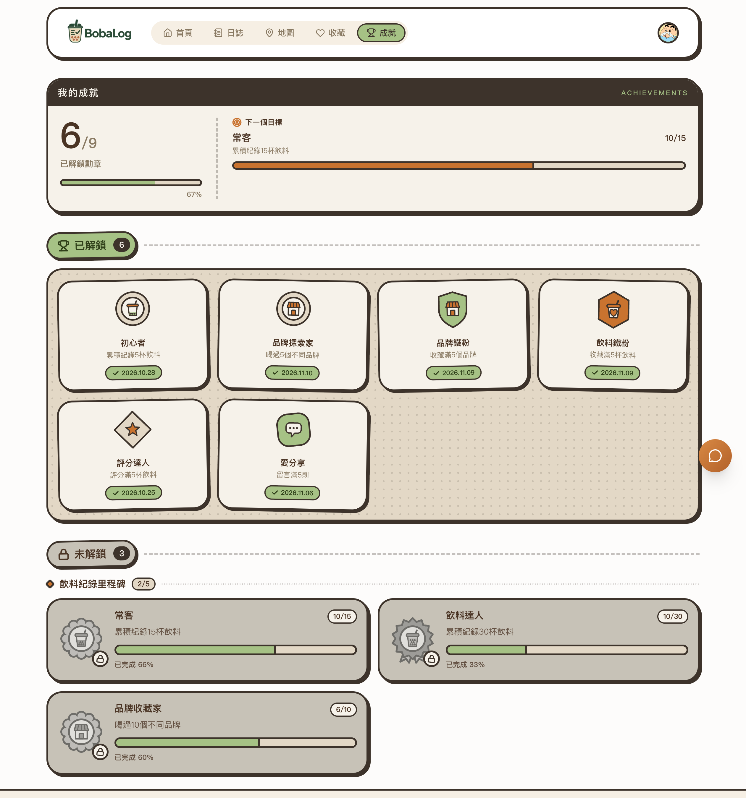

### AI聊天助手

用自然語言對話記帳或詢問附近有什麼好喝的,AI會依據地理位置、口味關鍵字給出候選飲料,也能直接拍照收據自動記錄多杯消費。

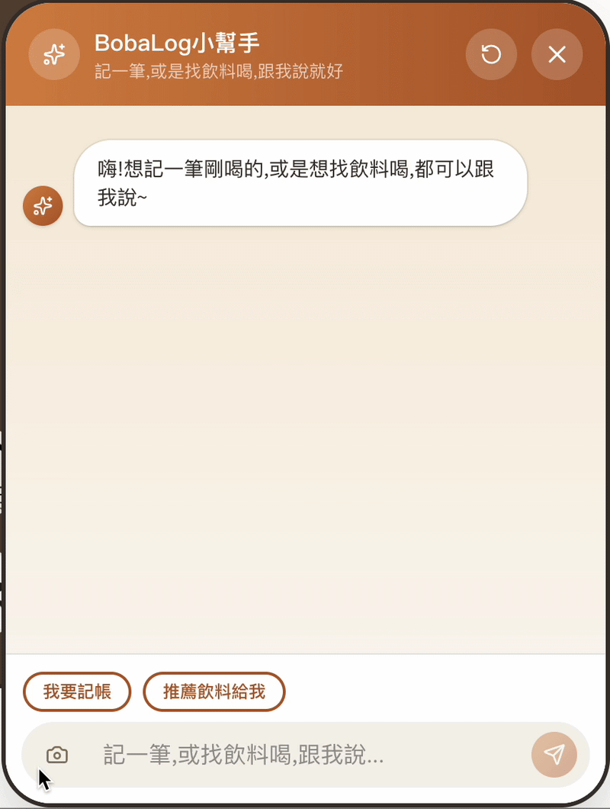
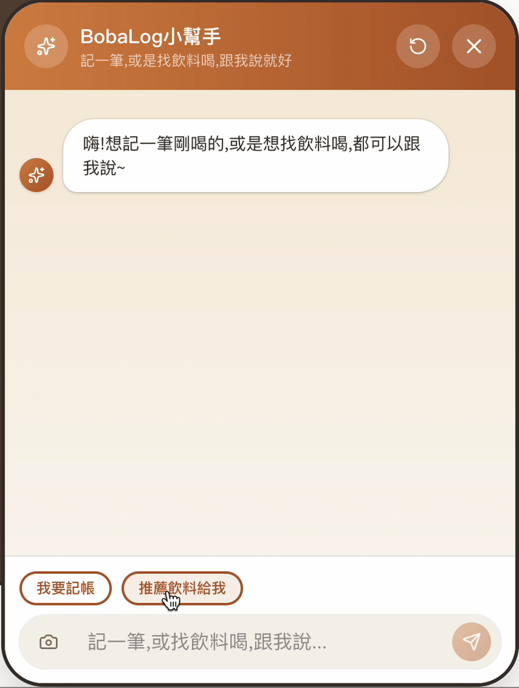

### 菜單回報審核

使用者可以拍照上傳品牌菜單,AI自動比對與現有資料的差異(新增、下架、改價),再由管理員逐項審核套用,維持菜單資料的正確性。

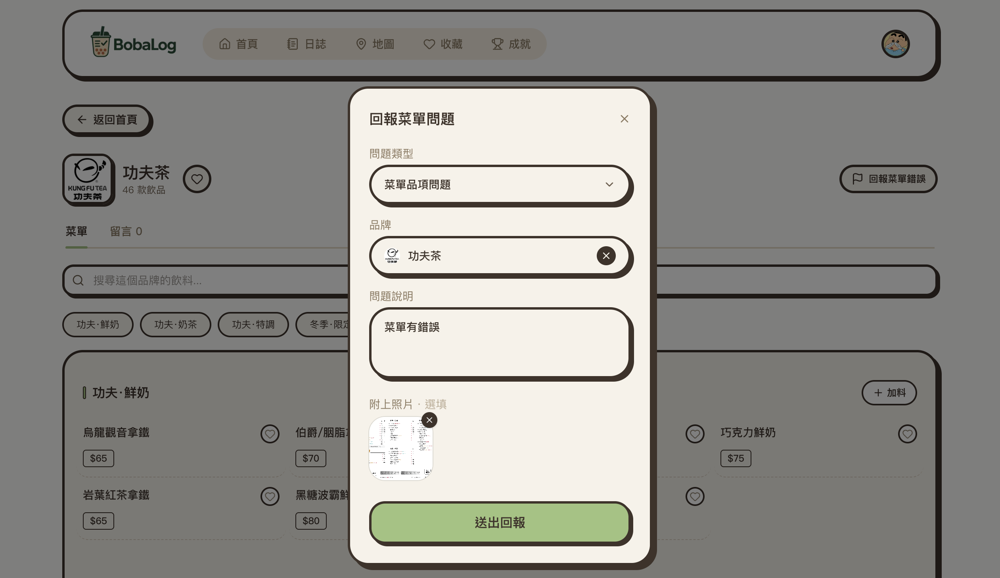
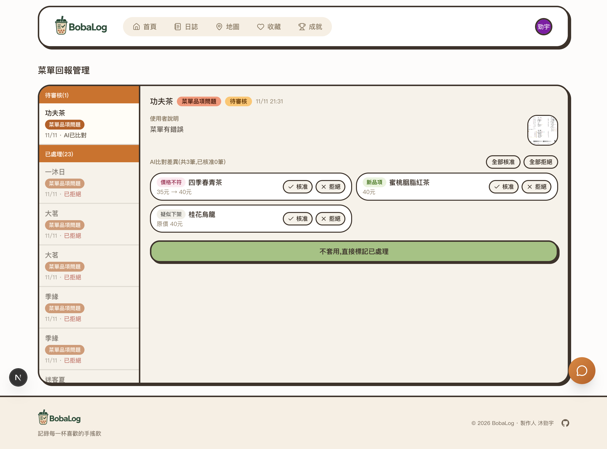

## 技術棧

| 分類 | 技術 |
| --- | --- |
| 前端 | Next.js 16(App Router)、React 19、TypeScript、Tailwind CSS 4、Framer Motion、SWR |
| 後端 | Firebase Cloud Functions、Firestore、Firebase Authentication、Firebase Storage |
| AI | Google Gemini(圖片/收據辨識、自動記帳抽取、菜單比對、飲料推薦) |
| 搜尋 | Algolia(品牌與飲料全文搜尋) |
| 地圖 | Google Maps Platform(Places API) |
| 部署 | Vercel(前端)、Firebase(後端) |

## 安裝與執行

### 需求

- Node.js 20+
- 一個Firebase專案(啟用Firestore、Authentication、Storage,並升級Blaze方案才能用Cloud Functions)
- Google Maps Platform API金鑰(啟用Places API)

### 前端

```bash
git clone https://github.com/<你的帳號>/bobalog.git
cd bobalog
npm install
```

在根目錄建立 `.env.local`:

```
NEXT_PUBLIC_FIREBASE_API_KEY=
NEXT_PUBLIC_FIREBASE_AUTH_DOMAIN=
NEXT_PUBLIC_FIREBASE_PROJECT_ID=
NEXT_PUBLIC_FIREBASE_STORAGE_BUCKET=
NEXT_PUBLIC_GOOGLE_MAPS_API_KEY=
NEXT_PUBLIC_GOOGLE_MAPS_MAP_ID=
```

啟動開發伺服器:

```bash
npm run dev
```

### 後端(Cloud Functions)

```bash
cd functions
npm install
```

把 `.firebaserc` 裡的專案ID換成自己的Firebase專案,並設定三組Secret Manager密鑰:

```bash
npx firebase-tools functions:secrets:set GEMINI_API_KEY
npx firebase-tools functions:secrets:set PLACES_API_KEY
npx firebase-tools functions:secrets:set ALGOLIA_WRITE_API_KEY
```

部署:

```bash
npx firebase-tools deploy --only functions
```

本機也可以用Emulator測試,不用真的部署:

```bash
npm run serve
```

## 已知限制與未來規劃

- 品牌與菜單資料仰賴人工建立或使用者回報,沒有自動爬取/更新機制,新開的店家不會自動出現
- 菜單回報的AI比對結果仍需要管理員人工逐項審核套用,沒有自動上架
- 地圖搜尋依賴Google Places資料,沒有登記在Google地圖上的店家不會被找到
- 目前沒有自動化測試,主要靠手動與ad-hoc腳本驗證邏輯正確性
- 未來規劃:自動化測試覆蓋、管理員後台管理菜單資料頁面、根據歷史紀錄做更個人化的飲料推薦

## 授權

本專案為課程作業,僅供學習與展示用途。